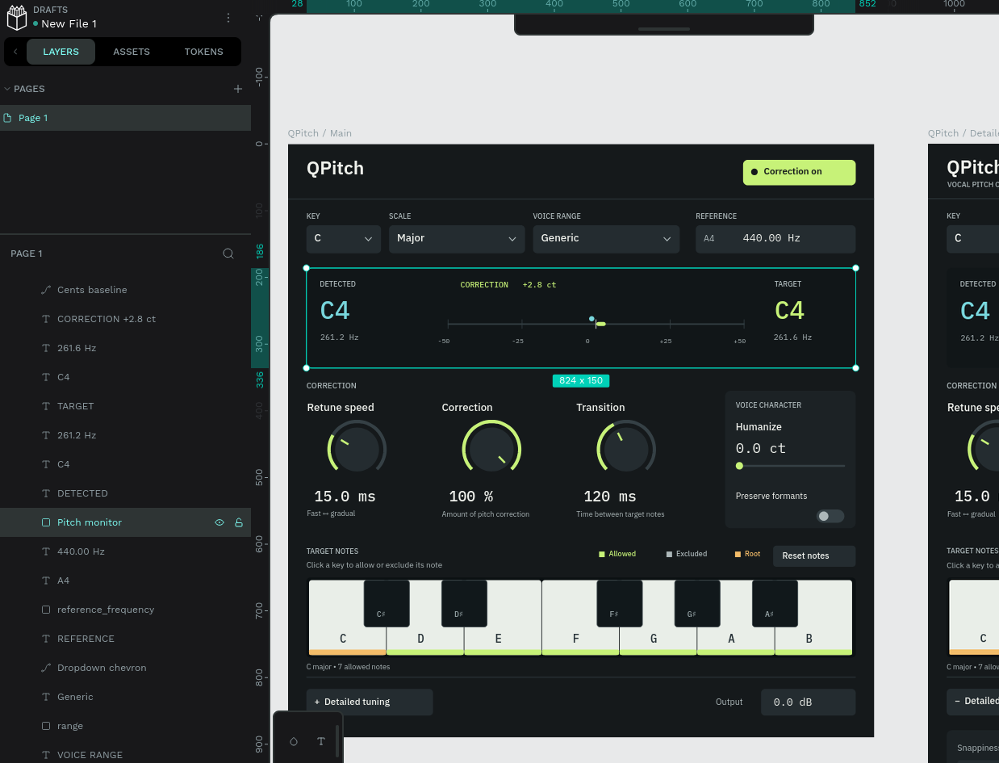

2.1

_____

QPitch 2.1 is all about making the tuning actually crisp.

Hard tune (Retune speed 0) now lands notes much more tightly. Tested on raw acapellas, the median error went from ~10 ct to ~2.5 ct, and the share of audio within 10 ct of the note went from ~45% to ~75%. The default settings also no longer leave vocals further off-pitch than the dry take.

What changed under the hood:
- Downward corrections were landing ~40 ms early inside Rubber Band. They're now delayed so pitch-up and pitch-down corrections both hit the audio they were measured on, with no extra latency.
- The pitch detector now measures the newest audio in its window, cutting its lag by ~15 ms.
- Correction runs on a fixed 128-sample grid, so results no longer change with your DAW's buffer size.

Controls, reworked so every one of them does something:
- **Retune speed** now pulls toward the note smoothly across its whole range (no more dead zone under 10 ms, and it no longer stops working when Transition is low).
- **Transition** keeps your natural slide into a new note for up to the set time, then snaps, instead of forcing a slow glide that lagged behind the voice.
- **T-Pain** is the one macro that pushes Retune speed and Transition toward instant, robotic steps.
- **Humanize** (now 0–100%) lets held notes keep their vibrato while short notes still snap.
- Removed **Snappiness** (duplicated T-Pain), **Tolerance time** and **Voice range** (neither had a measurable effect). Sessions saved with 2.0 still load; those settings are ignored.
- New defaults: Retune speed 10 ms, Transition 60 ms.

2.0

_____

QPitch 2.0 brings a cleaner, more compact theme, with live pitch markers right on the piano keys.

Also fixed the wet signal becoming too wide and phasey. Stereo processing now keeps the channels aligned, so vocals sound more focused

I spent a bit of time trying to get the UI nice and tidy. The mockup was done using penpot for the design system.

